<p align="center"></p>

# Lung adenocarcinoma, from genes to prediction: a full multi-omics project in the LSMA Analysis Lab

**What separates lethal lung adenocarcinomas from the rest, and can we predict them?**

This repository is a complete worked project from the **LSMA Analysis Lab**, the analysis platform of the [London School of Multiomics & AI](https://lsma.co.uk). One question is followed through six lab modules (bulk RNA-seq, single-cell RNA-seq, DNA methylation, somatic mutations, multi-omics integration and machine learning) and then tested in independent cohorts from Sweden, Norway, the USA and Singapore. Every analysis was run in the lab without writing analysis code; the lab's reports, figures and tables are here, with the scripts used for the cross-cohort checks.

| | |
|---|---|
| **Disease** | Lung adenocarcinoma (LUAD), the most common lung cancer |
| **Main data** | TCGA-LUAD (The Cancer Genome Atlas): RNA-seq, 450K methylation and somatic mutations of the same patients, with normal lung; a single-cell atlas of 18 patients' tumours from CELLxGENE |
| **Independent cohorts** | Uppsala, Sweden (RNA-seq and survival, 108 tumours, 19 normal lungs); Oslo, Norway (450K methylation, 164 tumours, 19 normal lungs); Broad, USA (183 exomes) and OncoSG, Singapore (302 exomes) |
| **Lab modules** | Bulk RNA-seq · Single-cell RNA-seq · DNA methylation · Somatic mutations · Multi-omics integration · Machine learning |
| **Lab run time** | **About 1 h 18 min for the six main analyses**: bulk 16 min 18 s, single cell 34 min 17 s, methylation 11 min 12 s, mutations 2 min 15 s, integration 10 min 2 s, machine learning 3 min 41 s. Validation and robustness runs: 21 min. Imports from TCGA: about 32 min |
| **Result** | What turns lung tissue into cancer replicates almost perfectly across countries and layers. Predicting death is much harder: a model mined from TCGA RNA did not transfer to Sweden, but a signature taken from the single-cell biology of solid tumours did |

---

## Introduction

### Lung cancer, and why this project

Lung cancer kills more people than any other cancer: about 1.8 million deaths a year worldwide (GLOBOCAN 2022). **Lung adenocarcinoma** is its most common form. It grows from the cells that line the small airways and air sacs, and it is the type most often found in people who have never smoked.

Two patients with tumours of the same size and stage can fare very differently. Some adenocarcinomas stay small and slow for years; others spread early. Part of the answer lies in the tumour itself:
- **its genes:** which ones are switched on or off;
- **its DNA:** which mutations it carries (*KRAS*, *EGFR*, *TP53*, *STK11*, *KEAP1*) and how its DNA methylation has changed;
- **its neighbourhood:** the immune and support cells it lives among;
- **its growth pattern:** pathologists already see this under the microscope. Lepidic, acinar and papillary tumours do better than **solid** and micropapillary ones.

### What this project is

Most published analyses look at one of these layers at a time. This repository follows **one question through every layer**, as a complete project would, from public raw data to a validated prediction:

| Chapter | Layer | The part of the question it answers |
|---|---|---|
| [1](#chapter-1-bulk-rna-seq) | Bulk RNA-seq | What changes when lung tissue becomes adenocarcinoma? |
| [2](#chapter-2-single-cell-rna-seq) | Single-cell RNA-seq | Which cells live in these tumours, and how do the tumour cells of solid tumours differ from those of acinar/papillary ones? |
| [3](#chapter-3-dna-methylation) | DNA methylation | Is the tumour's methylation rewired, and does it explain the genes of chapter 1? |
| [4](#chapter-4-somatic-mutations) | Somatic mutations | Which mutations drive these tumours, and do any go with death? |
| [5](#chapter-5-multi-omics-integration) | Integration | Do RNA, methylation and mutations of the same patients agree, and do they define groups with different survival? |
| [6](#chapter-6-machine-learning) | Machine learning | Can tumour RNA predict survival and advanced stage in patients the model has never seen? |
| [7](#validation) | Validation | Does each answer hold in independent cohorts, and do the layers point the same way? |

### How to read it

- **In a hurry:** read *Key findings* and the two validation figures.
- **Learning the methods:** each chapter has its own folder with the lab's full report, figures and tables, and its own short section here. *The mathematics behind the methods* gives the formulas.
- **Checking the work:** *Validation* lists every independent cohort and robustness run; *Limitations* lists what this project cannot tell you.

---

## Biological question and aim

**Question.** What separates lethal lung adenocarcinomas from the rest, and can we predict them?

**Hypothesis.**
- The change from normal lung to adenocarcinoma is large and consistent: faster division, a glycolytic metabolism, loss of lung-cell identity, and widespread methylation changes, with tobacco leaving its mark on the DNA.
- Within tumours, more aggressive disease should carry more of the same features (division, loss of differentiation), as the solid growth pattern suggests under the microscope.
- A predictor built on such biology should hold in other countries; one mined from a single cohort may not.

**Aims**
1. Describe the tumour against matched normal lung in RNA (chapter 1) and methylation (chapter 3), and the mutations that drive it (chapter 4).
2. Map the cells of the tumour and compare solid with acinar/papillary tumours, cell type by cell type (chapter 2).
3. Integrate RNA, methylation and mutations of the same 100 patients and look for patient groups with different survival (chapter 5).
4. Train survival and stage models and test them, frozen, in another country (chapter 6), using a new lab feature built for this project.
5. Replicate every layer in an independent cohort, and test a cross-layer signature (single cell → bulk survival) in two countries.

---

## Key findings

1. **What turns lung into cancer replicates almost perfectly** (Figure V1).
   - **RNA:** 4,599 genes change at least two-fold in TCGA tumours against matched normal lung. Of the 4,072 also measured in Uppsala, 95.4% change in the same direction and 87.0% are significant (ρ = 0.88).
   - **Methylation:** 72,380 CpGs change in TCGA. Of the 70,005 also measured in Oslo, 96.5% move the same way and 64.9% are significant (ρ = 0.86).
   - **Mutation frequencies** match a US cohort closely (ρ = 0.94) and a Singapore cohort less closely (ρ = 0.79), because East Asian tumours carry far more *EGFR* and less *KRAS* mutation (*EGFR* 47% in Singapore against 12% in TCGA).
2. **The tumours are dividing faster and burning glucose** (chapter 1). The gene sets most raised in tumours are E2F targets, MYC targets, the G2/M checkpoint, glycolysis and mTORC1 signalling. Normal lung genes fall, led by *SLC6A4*.
3. **Tobacco is written into the DNA** (chapter 4). 57% of all substitutions match the tobacco-smoke signature SBS4. *TP53* is mutated in 51% of tumours, *KRAS* in 22%, *KEAP1* in 20.5%, and *KRAS* and *TP53* tend to occur apart (adjusted p = 0.044).
4. **Methylation and expression move against each other** (Figure V1D). For 3,728 genes with called promoter CpGs, 62% go in opposite directions (ρ = −0.25, p = 2 × 10⁻⁵⁰): methylation helps switch genes off.
5. **Solid tumours have tumour cells of a different kind** (chapter 2). In 49,293 cells, 2,065 genes differ in tumour cells between solid and acinar/papillary tumours, more than in any other cell type. Solid tumour cells raise *FAM83A*, *HMGA1*, *IL1B*, *FSCN1* and *GAPDH* and lose lung-differentiation genes such as *ADRB2*, *MECOM* and *CLIC6*.
6. **That single-cell signature predicts death in two countries** (Figure V2). Scored in bulk tumours, the 100-gene solid signature gives a hazard ratio of 1.45 per standard deviation in TCGA (p = 0.002) and 1.32 in Uppsala (p = 0.064; log-rank p = 0.03). Its concordance is 0.60 in both.
7. **A model mined from TCGA did not transfer** (chapter 6, Figure V2C). A penalised Cox model reached a C-index of 0.64 on held-out TCGA patients but 0.49 in Uppsala, no better than chance. A classifier for stage III against stage I found no reliable signal.
8. **Integration did not find prognostic groups** (chapter 5). RNA and methylation agree strongly (Mantel r = 0.55), but the fused patient groups do not differ in survival (p = 0.31), and the lab's own comparison finds that RNA alone recovers survival status as well as any integration method.

**The answer to the question.** In lung adenocarcinoma, the biology of becoming cancer is robust and reproducible. The biology of being lethal is subtler: what generalises is a signature grounded in tumour-cell biology (the solid growth pattern), not a model fitted to one cohort's survival.

---

## Chapter 1: Bulk RNA-seq

**59 TCGA patients with tumour and matched normal lung** (119 samples), DESeq2 with a paired design (`~ patient + tissue`). Lab run time **16 min 18 s**. [Report (PDF)](01-bulk-rnaseq/report/LSMA-Analysis-Lab-report-lung-adenocarcinoma-bulk-rnaseq.pdf) · [HTML](01-bulk-rnaseq/report/LSMA-Analysis-Lab-report-lung-adenocarcinoma-bulk-rnaseq.html) · [tables](01-bulk-rnaseq/results)

- 19,617 genes tested; 14,579 change at adjusted p < 0.05, and **4,599 change at least two-fold** (1,683 up, 2,916 down).
- Tumour and normal separate on PC1 (41.6% of the variation; R² = 0.86 with tissue).
- GSEA: proliferation (E2F, G2/M, MYC) and glycolysis up; normal lung programmes down.

| | |
|---|---|
| 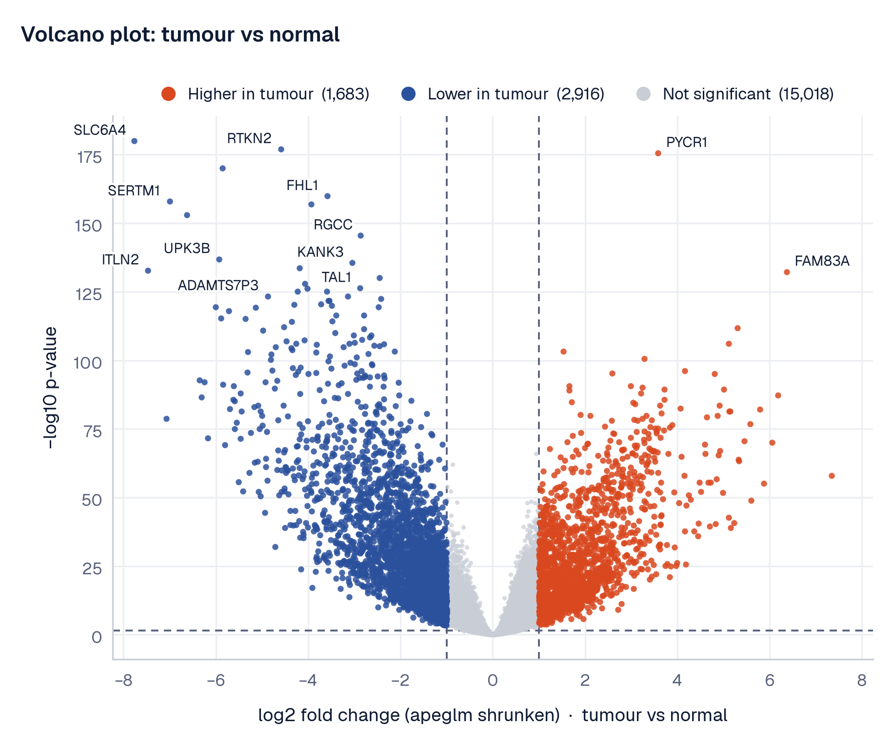 **Figure 1.1.** Tumour against matched normal lung. | 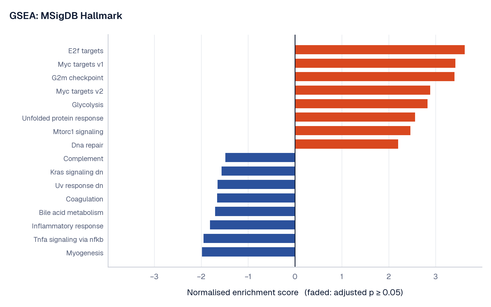 **Figure 1.2.** Hallmark gene sets (GSEA). |

## Chapter 2: Single-cell RNA-seq

**18 patients' tumours** (CELLxGENE; histologic subtype recorded for each patient), 55,114 cells (47% of each patient's cells, to fit the lab's 60,000-cell limit; [script](validation/data-preparation/sc_luad_subset.py)), **49,293 after quality control**. Harmony across patients, Leiden clustering, a lung tumour marker panel, pseudobulk DESeq2 for solid (4 patients) against acinar/papillary (6 patients), and the extended stages. Lab run time **34 min 17 s**, plus a short re-run of the extended stage after its trajectory root was corrected. [Report (PDF)](02-single-cell/report/LSMA-Analysis-Lab-report-lung-adenocarcinoma-single-cell.pdf) · [HTML](02-single-cell/report/LSMA-Analysis-Lab-report-lung-adenocarcinoma-single-cell.html) · [tables](02-single-cell/results)

- **14 cell types**: tumour cells, CD4 and CD8 T cells, regulatory T cells, NK cells, B and plasma cells, macrophages, monocytes, dendritic cells, mast cells, fibroblasts, endothelial and cycling cells. The lab's labels agree with the authors' for **84% of cells** (98–100% for tumour cells, B cells, fibroblasts and endothelium; most disagreements are between T-cell subtypes).
- **Solid against acinar/papillary:** 2,065 genes differ in tumour cells; between 0 and 363 in each other cell type (table `pseudobulk_summary.tsv`).
- **Extended stages:** cell cycle (22.6% of cells in S or G2/M), trajectory (PAGA and diffusion pseudotime, rooted at classical monocytes), differential abundance (no cell type changes significantly with 4 against 6 patients), and cell–cell communication (LIANA, 145,313 ligand–receptor pairs scored).

| | |
|---|---|
| 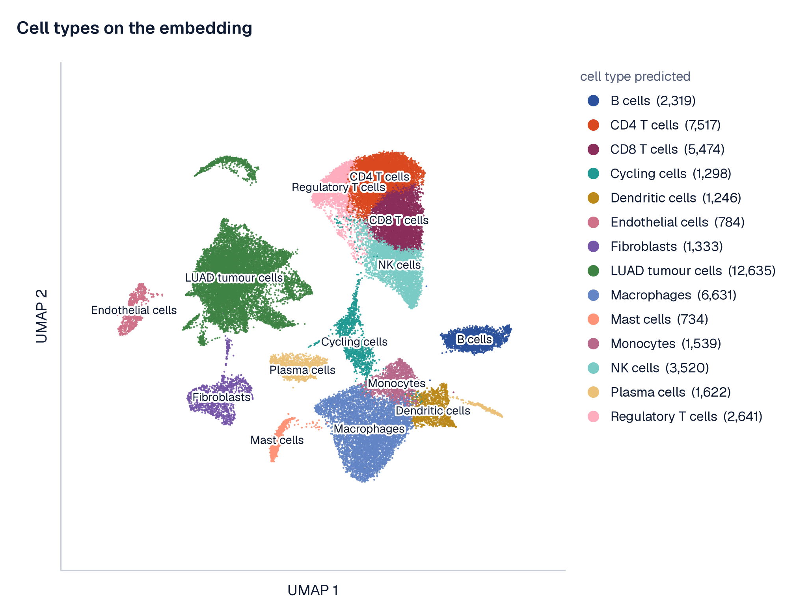 **Figure 2.1.** The 14 cell types. | 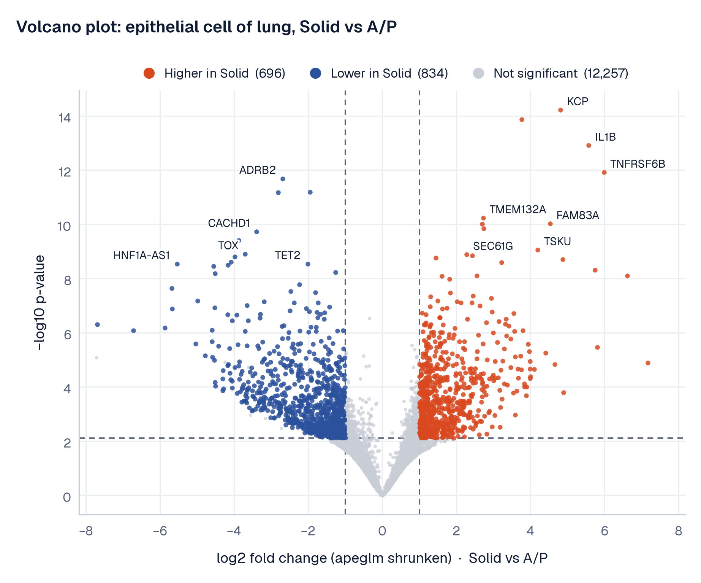 **Figure 2.2.** Tumour cells, solid against acinar/papillary. |
| 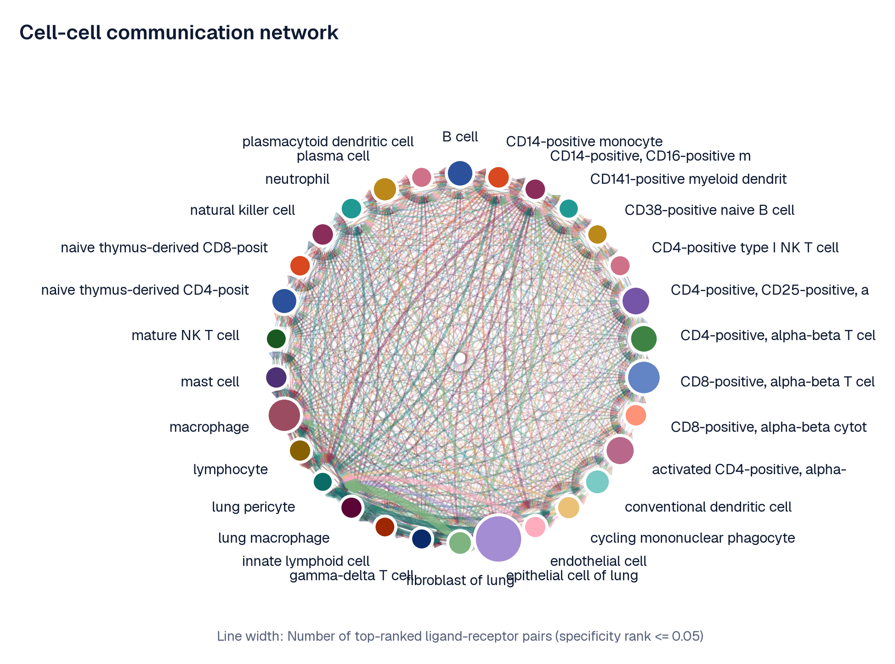 **Figure 2.3.** Cell–cell communication network. | 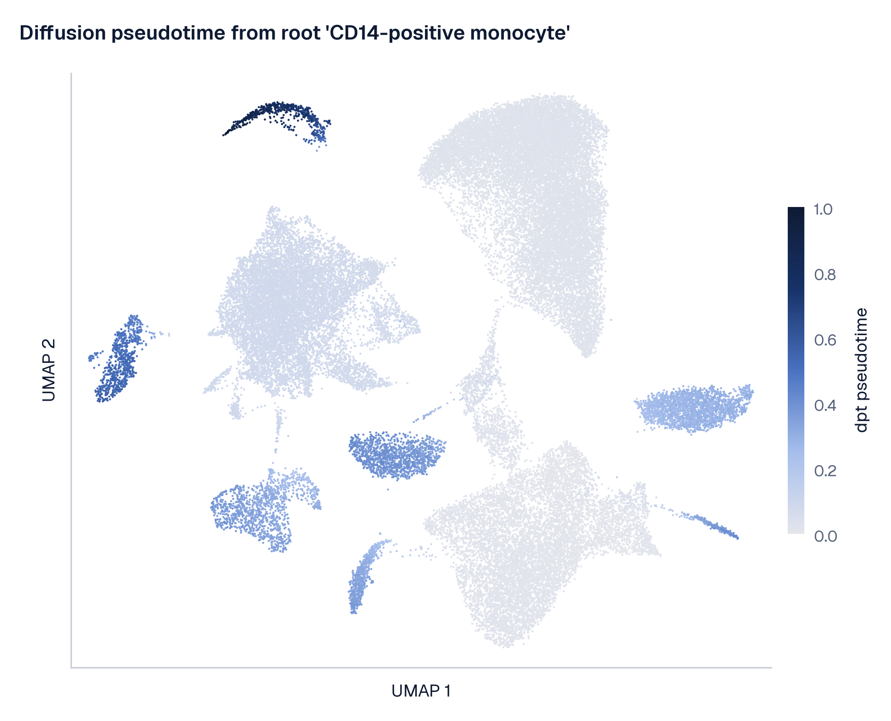 **Figure 2.4.** Diffusion pseudotime. |

## Chapter 3: DNA methylation

**32 TCGA patients with tumour and matched normal lung** (450K), limma on M-values with a paired design, DMRcate regions. Lab run time **11 min 12 s**. [Report (PDF)](03-dna-methylation/report/LSMA-Analysis-Lab-report-lung-adenocarcinoma-methylation.pdf) · [HTML](03-dna-methylation/report/LSMA-Analysis-Lab-report-lung-adenocarcinoma-methylation.html) · [tables](03-dna-methylation/results)

- 373,391 CpGs after quality control (7,982 on the sex chromosomes and 1,474 at common SNPs removed).
- **72,380 CpGs change** by at least 0.1 in β (34,207 gain, 38,173 lose methylation); **11,455 regions**, led by *TBX15* and *ZIC4*.
- Tumour and normal separate on PC1 (54.9% of the variation).

| | |
|---|---|
| 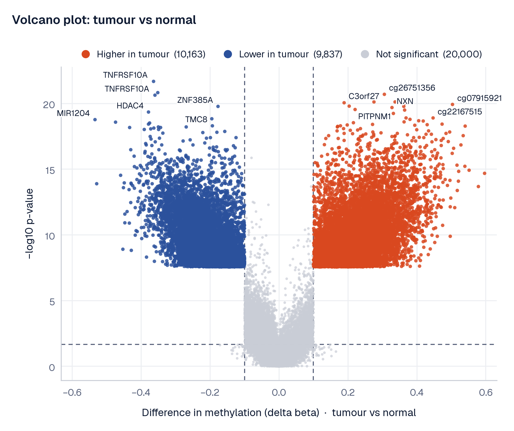 **Figure 3.1.** CpGs, tumour against normal. | 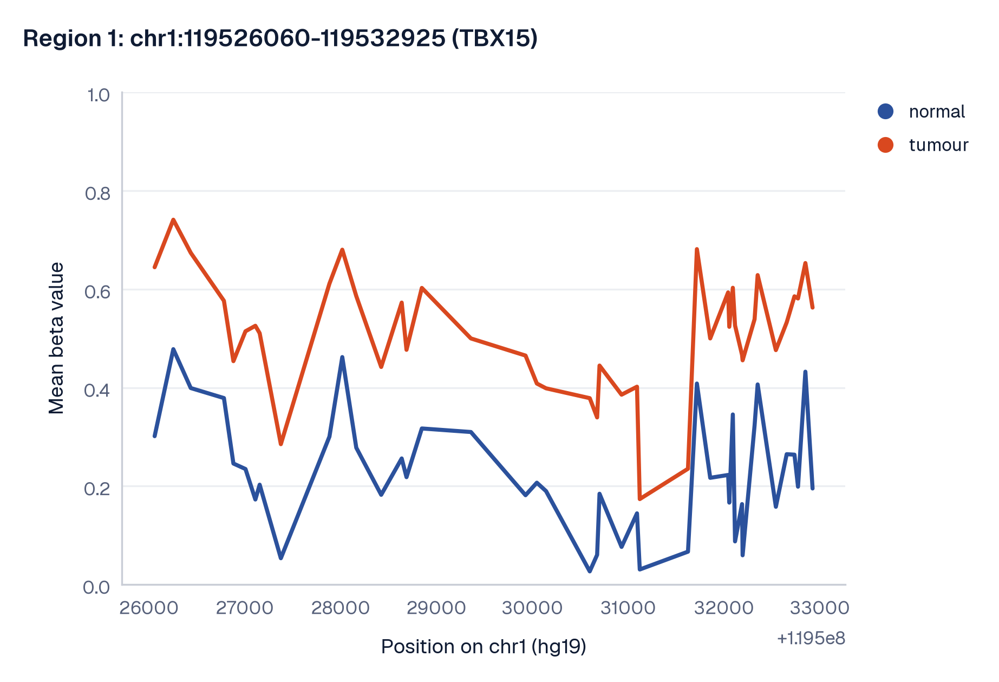 **Figure 3.2.** The top region. |

## Chapter 4: Somatic mutations

**200 TCGA tumours** (the same patients as chapters 5 and 6), with copy number. Lab run time **2 min 15 s**. [Report (PDF)](04-mutations/report/LSMA-Analysis-Lab-report-lung-adenocarcinoma-mutations.pdf) · [HTML](04-mutations/report/LSMA-Analysis-Lab-report-lung-adenocarcinoma-mutations.html) · [tables](04-mutations/results)

- Median **4.3 mutations per megabase**; transitions/transversions 0.46, typical of tobacco.
- **SBS4 (tobacco smoke) 57%** of substitutions; APOBEC (SBS2, SBS13) 10%.
- *TP53* 51%, *KRAS* 22%, *KEAP1* 20.5%, *EGFR* 12%, *NF1* 11%, *SMARCA4* 10.5%, *STK11* 8%, *BRAF* 8%.
- **No gene differs between patients who died and those alive** after correction (82 against 115).

| | |
|---|---|
| 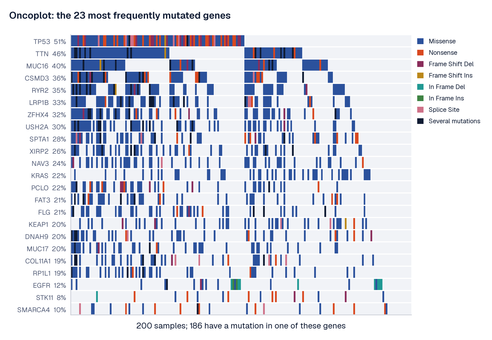 **Figure 4.1.** The most frequently mutated genes. | 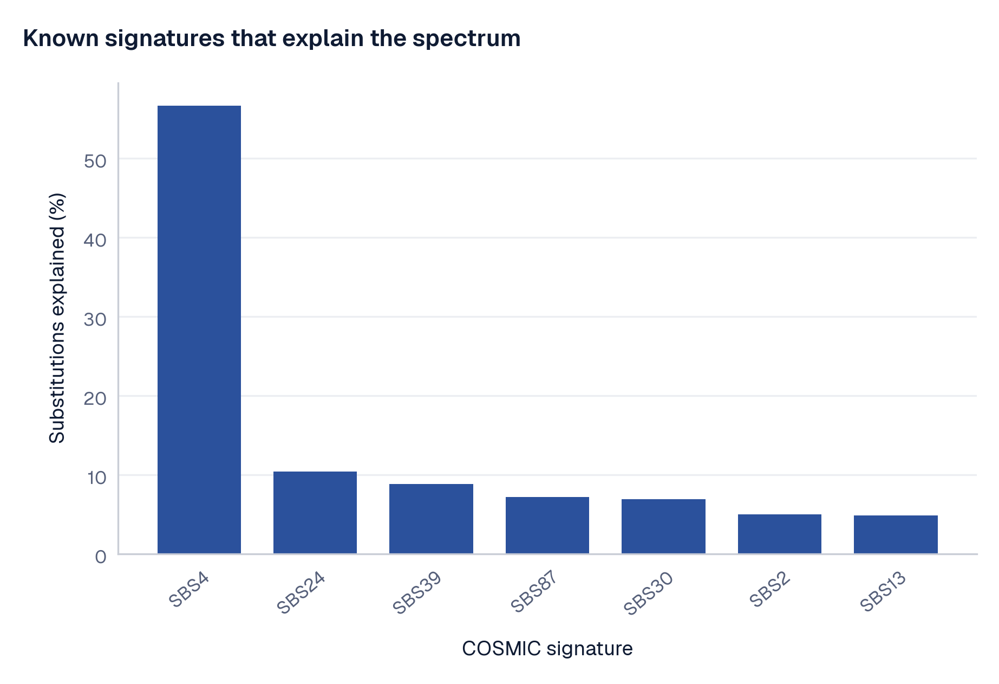 **Figure 4.2.** Mutational signatures: tobacco dominates. |

## Chapter 5: Multi-omics integration

**100 patients with RNA, methylation and mutations** (the lab imports at most 100 TCGA methylation arrays). MOFA, similarity network fusion, DIABLO and a method comparison. Lab run time **10 min 2 s**. [Report (PDF)](05-integration/report/LSMA-Analysis-Lab-report-lung-adenocarcinoma-multi-omics.pdf) · [HTML](05-integration/report/LSMA-Analysis-Lab-report-lung-adenocarcinoma-multi-omics.html) · [tables](05-integration/results)

- **Expression and methylation agree** (Mantel r = 0.55, p = 0.002); mutations agree a little with methylation (r = 0.22, p = 0.002) and not with expression (r = 0.03).
- **MOFA: 7 factors**, 6 shared between layers; none is linked to death, stage or survival time after correction (smallest adjusted p = 0.07).
- **SNF: 2 groups** (55 and 45 patients), survival not different (log-rank p = 0.31).
- **DIABLO** predicts death no better than shuffled labels (balanced error 0.41, permutation p = 0.14).
- The lab's comparison warns that RNA alone recovers survival status as well as any integration method.

| | |
|---|---|
| 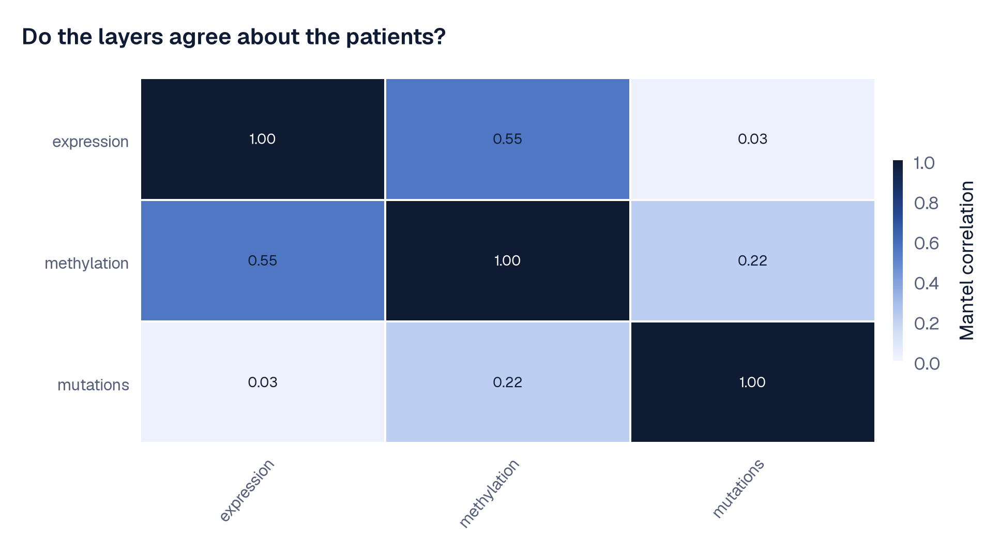 **Figure 5.1.** How far the layers agree. | 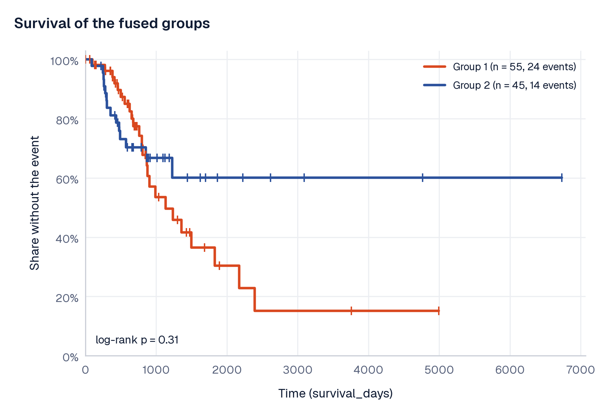 **Figure 5.2.** Survival of the fused groups. |

## Chapter 6: Machine learning

**200 TCGA tumours.** A penalised Cox model for survival (82 deaths) and six classifiers for stage III against stage I. Lab run time **30 s and 3 min 11 s**. [Survival report](06-machine-learning/report/LSMA-Analysis-Lab-report-lung-adenocarcinoma-survival-model.pdf) · [Stage report](06-machine-learning/report/LSMA-Analysis-Lab-report-lung-adenocarcinoma-stage-model.pdf) · [tables](06-machine-learning/results)

- **Survival:** the model chooses the 50 genes most related to survival inside each fold, then 39 keep a weight (*HNRNPAB*, *AKAP12*, *NKX2-1*, …). Held-out TCGA patients: C-index 0.64 (0.50–0.78), log-rank p = 0.04.
- **Frozen on Uppsala** (108 patients, 49 deaths), with the lab's new prediction task: C-index **0.49** (0.40–0.60). The model does not transfer.
- **Stage III against stage I:** cross-validated AUC 0.64 (better than shuffled labels, p = 0.02), but 0.47 on held-out TCGA patients and 0.60 (0.46–0.74) in Uppsala. Stage III is defined by spread to lymph nodes, which the primary tumour's RNA hardly shows.

| | |
|---|---|
| 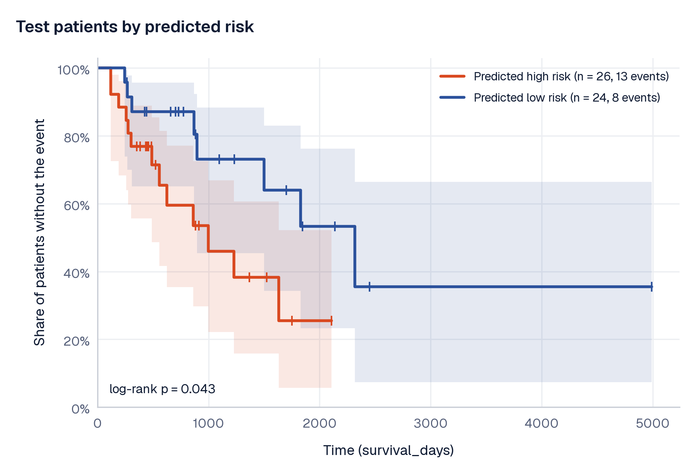 **Figure 6.1.** Held-out TCGA patients by predicted risk. | 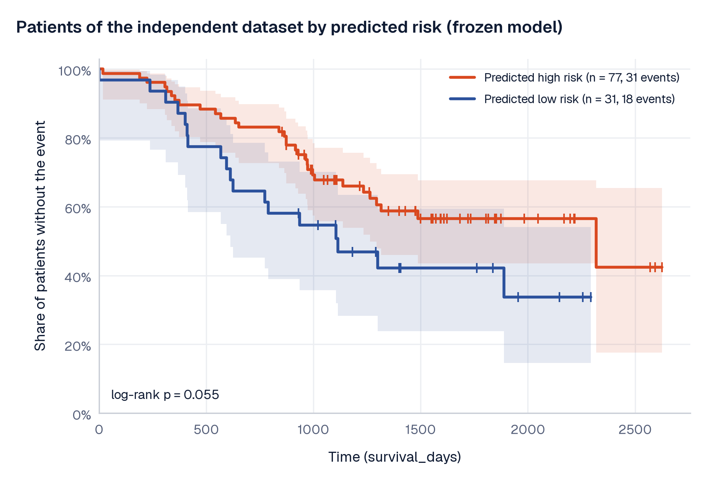 **Figure 6.2.** The same model, frozen, in Uppsala. |

---

## Quality control and PCA

| Layer | Check | Result |
|---|---|---|
| Bulk RNA | samples, genes | 119 samples (59 normal, 60 tumour); 60,660 → 19,617 genes kept (filterByExpr); size factors 0.43–2.69; 7 samples flagged, kept |
| Single cell | cells, genes | 55,114 → 49,293 cells (median 1,658 genes, 6.7% mitochondrial reads); 24 doublets removed; patients mixed after Harmony (mixing 0.49 → 0.80) |
| Methylation | probes, samples | 421,313 → 373,391 CpGs; 82 arrays (32 normal, 50 tumour, 32 pairs used by the paired model) |
| Mutations | samples | 200 tumours, 46,416 protein-changing mutations; one hypermutated tumour flagged (kept) |
| Integration | patients, features | 100 patients in every layer; 2,000 genes, 2,000 CpGs (sex-chromosome probes removed), mutated genes with ≥ 5 carriers |

| | |
|---|---|
| 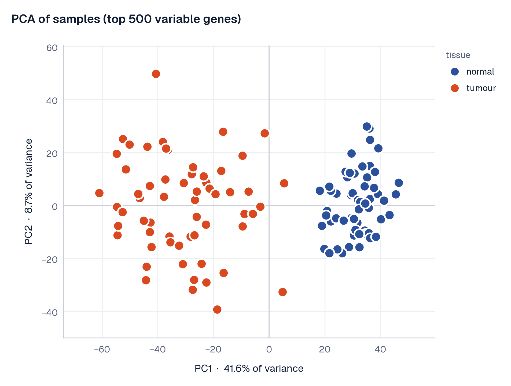 **QC1.** Bulk RNA: tumour and normal separate on PC1. | 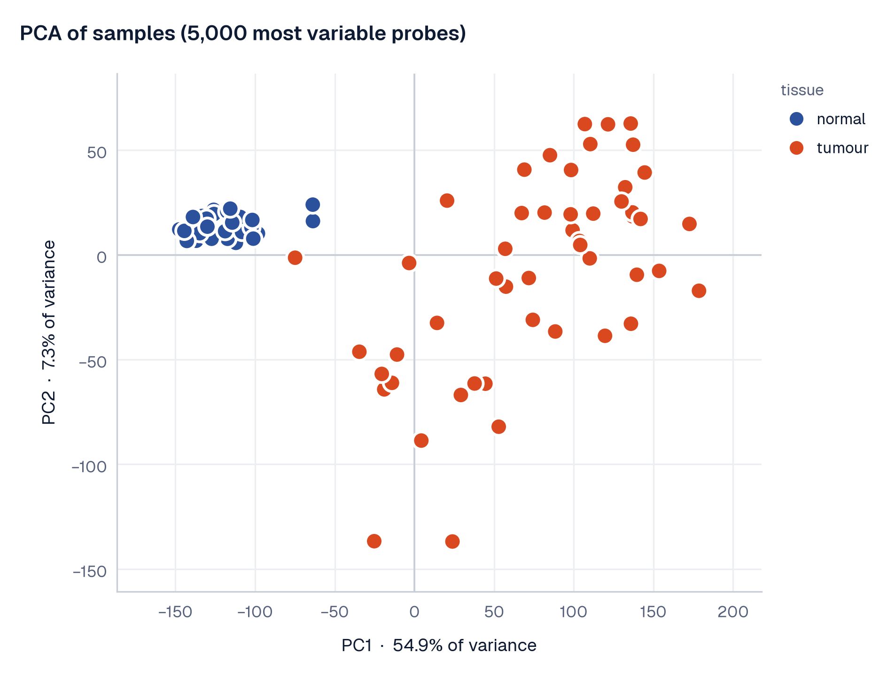 **QC2.** Methylation: the same on PC1. |
| 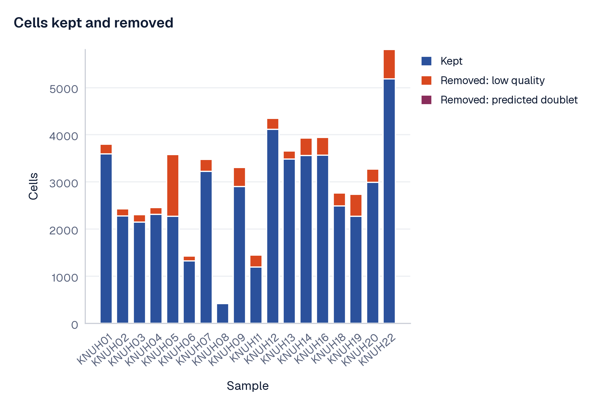 **QC3.** Single-cell quality control. | 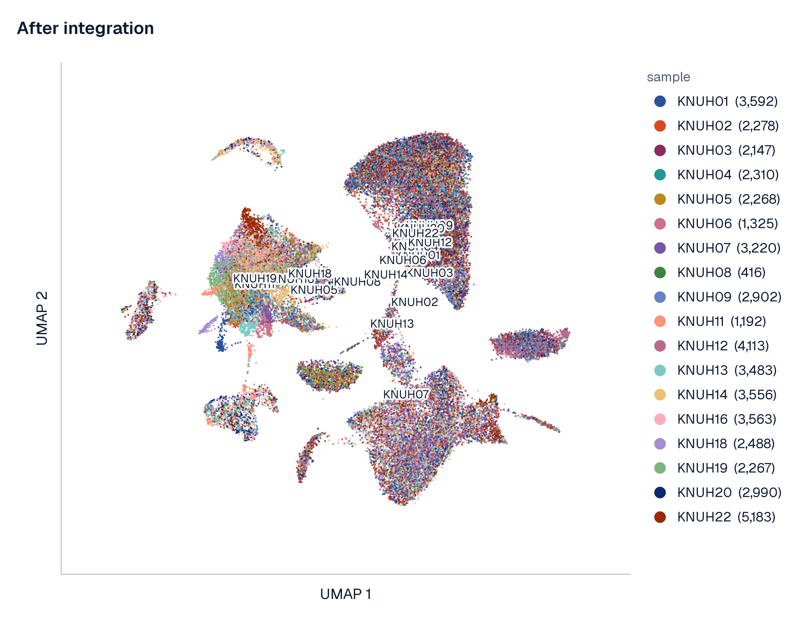 **QC4.** Cells coloured by patient after Harmony. |

---

## Workflow

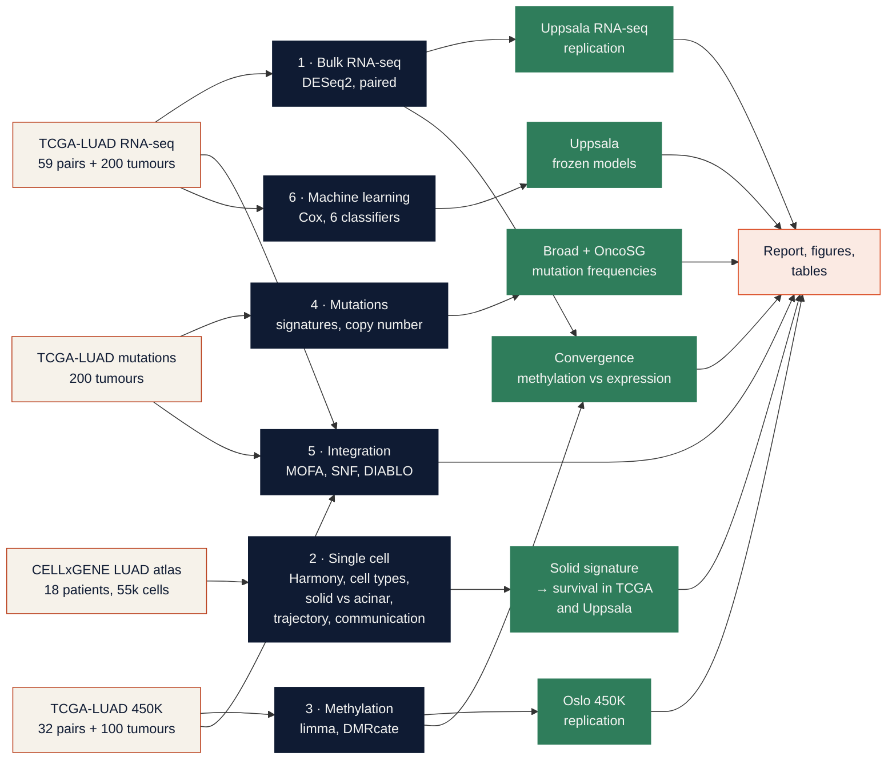

## How it was done

Every analysis is a module of the LSMA Analysis Lab, run with the settings in [`settings/analysis-settings.json`](settings/analysis-settings.json).

1. **Import.** TCGA-LUAD from the NCI Genomic Data Commons in the lab:
   - RNA-seq of tumours and normal lung, with patients who have both preferred;
   - 200 tumours for mutations, then RNA-seq and methylation **asking for the same patients**;
   - methylation of tumours and normal lung.
2. **Single-cell data.** The CELLxGENE atlas (117,266 cells) is larger than the lab's limit, so 47% of each patient's cells were drawn at random (seed 2026) and uploaded ([script](validation/data-preparation/sc_luad_subset.py)).
3. **Bulk RNA-seq.** filterByExpr, DESeq2 median-of-ratios normalisation, `~ patient + tissue`, apeglm shrinkage, Benjamini–Hochberg, GSEA and over-representation on Hallmark, GO, KEGG and Reactome.
4. **Single cell.** Per-patient median ± MAD quality control and Scrublet; log-normalisation, Seurat v3 variable genes per patient, PCA (30 components), Harmony, Leiden (resolution 0.8), marker scoring with a lung panel; pseudobulk DESeq2 per cell type, `~ luad_histologic_subtype` (Solid against A/P); cell cycle, PAGA and diffusion pseudotime, edgeR differential abundance, LIANA communication.
5. **Methylation.** Removal of sex-chromosome, SNP and non-CpG probes; limma on M-values, `~ tissue + patient`; |Δβ| ≥ 0.1 and adjusted p < 0.05; DMRcate (λ = 1,000, C = 2); missMethyl enrichment.
6. **Mutations.** maftools landscape and interactions, COSMIC v3.2 signature refit, Fisher's tests for died against alive, copy-number frequencies.
7. **Integration.** The three datasets combined by patient in the lab; 2,000 most variable features per continuous layer; Mantel tests, MOFA2, SNF (20 neighbours, σ = 0.5), DIABLO (5-fold cross-validation × 10, 50 shuffles), and a comparison with each layer alone.
8. **Machine learning.** 25% of patients held out; survival by a penalised Cox model with the genes most associated with survival chosen inside every fold; stage by six classifiers compared in nested cross-validation with 100 label shuffles.
9. **Validation** (outside the lab, scripts in [`validation/scripts/`](validation/scripts)): cohort-to-cohort comparisons, the solid signature's survival tests and the figures.

**Software:** R 4.5 / Bioconductor 3.21 (DESeq2, limma, DMRcate, missMethyl, maftools, MutationalPatterns, MOFA2, SNFtool, mixOmics, edgeR) and Python 3.12 (Scanpy, Harmony, LIANA, scikit-learn, lifelines), in the versions listed in the settings file.

## The mathematics behind the methods

The core formulas of the project, in the form the lab's code uses. Each companion repository has a fuller section for its own module.

**Negative binomial model with the paired design (bulk RNA and pseudobulk).**

$$
K_{ij} \sim \mathrm{NB}(\mu_{ij}, \alpha_i), \qquad \mu_{ij} = s_j q_{ij}, \qquad \log_2 q_{ij} = \beta_{i0} + \gamma_{i,p(j)} + \beta_{i1} x_j
$$

$K_{ij}$ is the count of gene $i$ in sample $j$, $s_j$ the sample's size factor, $\alpha_i$ the gene's dispersion, $x_j$ is 1 for tumour and 0 for normal, and $\gamma_{i,p(j)}$ the patient's own level. $\beta_{i1}$ is the log2 fold change within patients, tested by the Wald statistic $\hat\beta_{i1} / \mathrm{SE}(\hat\beta_{i1})$.

**Beta value, M-value and the moderated t-statistic (methylation).**

$$
\beta = \frac{M}{M + U + \alpha}, \qquad m = \log_2 \frac{\beta}{1 - \beta}, \qquad \tilde t_g = \frac{\hat\tau_g}{\tilde s_g \sqrt{v_g}}, \qquad \tilde s_g^2 = \frac{d_0 s_0^2 + d_g s_g^2}{d_0 + d_g}
$$

$M$ and $U$ are the methylated and unmethylated signals. Tests run on M-values, where the variance is more even. limma shrinks each CpG's variance $s_g^2$ towards a prior $s_0^2$ estimated from all CpGs, so a CpG with a tiny variance by chance cannot look significant.

**Benjamini–Hochberg adjustment (every layer).**

$$
p^{\text{adj}}_{(k)} = \min_{l \ge k} \min\left( 1, \frac{m p_{(l)}}{l} \right)
$$

$p_{(1)} \le \dots \le p_{(m)}$ are the sorted p-values of the $m$ tests; calling at 0.05 keeps the expected share of false discoveries at 5%.

**Mutational signatures.**

$$
\hat e = \underset{e \ge 0}{\arg\min} \lVert m - S e \rVert^2
$$

$m$ counts the substitutions in the 96 trinucleotide contexts, $S$ holds the COSMIC signatures as columns, and $\hat e$ is how many substitutions each signature explains (SBS4, tobacco smoke, explains 57% here).

**MOFA factors and similarity network fusion (integration).**

$$
Y^{(m)} = Z W^{(m)\top} + \varepsilon^{(m)}, \qquad P^{(v)} \leftarrow S^{(v)} \left( \frac{1}{m - 1} \sum_{k \ne v} P^{(k)} \right) S^{(v)\top}
$$

MOFA writes each layer $Y^{(m)}$ as shared patient factors $Z$ times layer-specific weights $W^{(m)}$. SNF lets each layer's patient network $P^{(v)}$ absorb the others through its $K$ nearest neighbours $S^{(v)}$, for 20 rounds, before the fused network is clustered.

**Penalised Cox model (machine learning).**

$$
\hat\beta = \underset{\beta}{\arg\max} \ \ell(\beta) - n \lambda \left( \rho \lVert \beta \rVert_1 + \frac{1 - \rho}{2} \lVert \beta \rVert_2^2 \right), \qquad \ell(\beta) = \sum_{i : \delta_i = 1} \left( \beta^\top x_i - \log \sum_{j \in R(t_i)} e^{\beta^\top x_j} \right)
$$

$\ell$ is the log partial likelihood ($\delta_i = 1$ if patient $i$ died; $R(t_i)$ the patients still followed then), $\lambda$ the penalty chosen by cross-validation and $\rho = 0.5$ the share of L1.

**The solid signature score and its test (validation).**

$$
S_j = \frac{1}{|U|} \sum_{g \in U} z_{gj} - \frac{1}{|D|} \sum_{g \in D} z_{gj}, \qquad h(t \mid S) = h_0(t) e^{\theta S}
$$

$U$ and $D$ are the 50 genes most raised and the 50 most lowered in solid tumour cells (single-cell pseudobulk), fixed before any survival data were looked at. $z_{gj}$ is gene $g$'s log2(CPM + 1) in tumour $j$, standardised within the cohort. The Cox model gives the hazard ratio $e^{\theta}$ per standard deviation of $S$.

**Concordance index (survival models and the signature).**

$$
C = \frac{\sum_{i,j} \mathbf{1}[t_i < t_j] \delta_i \left( \mathbf{1}[r_i > r_j] + \tfrac{1}{2} \mathbf{1}[r_i = r_j] \right)}{\sum_{i,j} \mathbf{1}[t_i < t_j] \delta_i}
$$

The share of comparable patient pairs in which the one who died sooner had the higher risk score $r$: 0.5 is guessing, 1 a perfect ranking.

---

## Validation

### 1. Every layer in an independent cohort

| Layer | Discovery (TCGA) | Independent cohort | Agreement |
|---|---|---|---|
| Bulk RNA, tumour vs normal | 4,072 strongly changed genes measured in both | Uppsala, Sweden: 108 tumours, 19 normal lungs ([GSE81089](https://www.ncbi.nlm.nih.gov/geo/query/acc.cgi?acc=GSE81089)), run in the lab (3 min 31 s) | **95.4%** same direction, **87.0%** significant, ρ = 0.88 |
| Methylation, tumour vs normal | 70,005 called CpGs measured in both | Oslo, Norway: 164 tumours, 19 normal lungs ([GSE66836](https://www.ncbi.nlm.nih.gov/geo/query/acc.cgi?acc=GSE66836)), run in the lab (8 min 2 s) | **96.5%** same direction, **64.9%** significant, ρ = 0.86 |
| Mutation frequencies | 29 genes | Broad, USA (183 exomes) and OncoSG, Singapore (302 exomes), from cBioPortal | ρ = **0.94** and **0.79** |
| Single-cell labels | 14 lab cell types | the authors' own labels | **84%** of cells agree |

The Singapore cohort differs as expected: *EGFR* in 47% (TCGA 12%), *KRAS* in 11% (TCGA 22%), the known East Asian pattern ([`validation/tables/mutation_frequencies_tcga_broad_oncosg.tsv`](validation/tables/mutation_frequencies_tcga_broad_oncosg.tsv)).

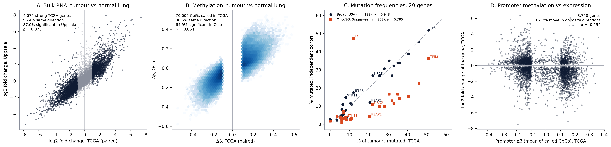

**Figure V1.**
- **A:** gene fold changes, TCGA against Uppsala.
- **B:** CpG Δβ, TCGA against Oslo.
- **C:** mutation frequencies, TCGA against the US and Singapore cohorts.
- **D:** promoter methylation against expression of the same genes.

### 2. What predicts death, and what transfers

| Predictor | Built on | TCGA (unseen patients) | Uppsala, Sweden |
|---|---|---|---|
| Penalised Cox model (39 genes) | TCGA survival | C 0.64 (0.50–0.78), p = 0.04 | **C 0.49 (0.40–0.60): no transfer** |
| Stage III vs I classifier | TCGA stage | AUC 0.47 | AUC 0.60 (0.46–0.74) |
| **Solid signature (100 genes)** | **single-cell biology, no survival data** | **HR 1.45 per SD, p = 0.002; C 0.60 (0.53–0.67)** | **HR 1.32, p = 0.064; log-rank p = 0.03; C 0.60 (0.51–0.68)** |

- **The frozen-model test was run inside the lab**, with a prediction task added to the machine learning module for this project (see *What changed in the lab*). It found 15,782 of the model's 17,485 genes in Uppsala, filled the 4 missing model genes with their training means, and flagged 2 genes whose level differs by more than two standard deviations between the cohorts.
- **The solid signature was fixed before any survival data were seen**: the 50 most significant up and down genes of tumour cells in solid against acinar/papillary tumours. Adjusted for stage, its hazard ratio falls to 1.32 (p = 0.058) in TCGA and 1.27 (p = 0.11) in Uppsala: part of its signal is that solid tumours are more often advanced.
- **Robustness:** choosing the 50 most variable genes instead of the 50 most survival-related gave a weaker survival model (held-out C 0.60, log-rank p = 0.77). Integration with 1,000 instead of 2,000 features per layer gave the same layer agreement (Mantel r = 0.52) and, again, no survival difference between groups (p = 0.56).

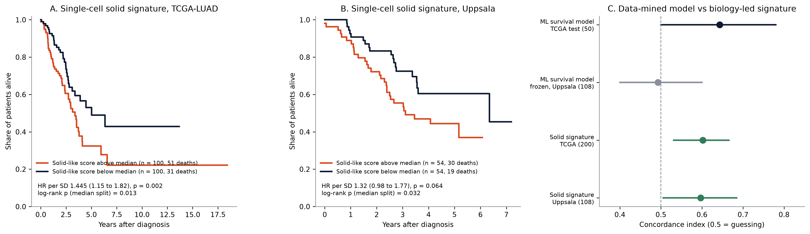

**Figure V2.**
- **A, B:** survival by the solid signature in TCGA and Uppsala (median split).
- **C:** concordance of the data-mined model and of the signature, with 95% bootstrap intervals.

**Verdict: the description of the disease is robust in every layer and every country tested. Prediction of death is modest, and only the biology-led signature carried over to another country.**

---

## What changed in the lab

This project led to changes in the lab, as the series is meant to:
- **A new "prediction" task in machine learning.** A model trained in one run can now be applied, unchanged, to another dataset, with the external C-index or AUC, risk groups at the original cut-off, and a report of missing and shifted genes. This is the frozen-model test in chapter 6.
- **Survival models choose genes related to survival.** The Cox model now picks the genes most associated with survival inside every cross-validation fold, instead of the most variable genes. In this project that raised the held-out C-index from 0.60 to 0.64.
- **Clearer survival-model reports.** Weights are counted relative to the largest one, the penalty grid is wider, and the lab warns when the chosen penalty is at the edge of the grid. The first run of this project reported "0 genes" for a model that ranked patients well, which led to this fix.
- **Not yet fixed:** transcription-factor activity (decoupler with CollecTRI) needs more memory than the lab's worker has for 49,000 cells; scoring cells in batches would solve it. The lab currently skips the module with a message.

These changes are in review for the live lab and are already used in this repository's runs.

---

## Limitations

- **Two countries for survival.** The prognostic tests use TCGA and Uppsala only; the signature's Uppsala result is borderline (p = 0.064 for the continuous score, 0.03 for the median split).
- **Small single-cell comparison.** Solid against acinar/papillary rests on 4 against 6 patients, and 47% of each patient's cells. Pseudobulk testing treats patients, not cells, as the replicates, which is right but leaves little power.
- **Stage partly explains the signature.** After adjustment for stage, the signature's effect is smaller and borderline. It is not shown here to add to stage in a clinical sense.
- **Cohorts differ.** Uppsala is a surgical cohort operated in 2006–2010 with long follow-up; TCGA follow-up is shorter (median 2.1 years for these 200 patients). Two genes of the survival model are shifted between TCGA and Uppsala.
- **No normal lung in the single-cell data**, so cell-level tumour-against-normal comparisons are not possible here.
- **Integration uses 100 patients**, because the lab imports at most 100 TCGA methylation arrays.
- **No transcription-factor activity** for this atlas (see above).
- **A teaching example, not clinical advice.** Nothing here should be used to diagnose, predict outcome for, or treat anyone.

---

## Repository structure

```
lsma-lab-full-project-lung-adenocarcinoma/
├── README.md                  this project
├── LICENSE                    CC BY 4.0
├── assets/                    animated banner
├── 01-bulk-rnaseq/            report/ (PDF, HTML) · figures/ · results/
├── 02-single-cell/            report/ · figures/ (cell types, solid vs acinar, trajectory, communication) · results/
├── 03-dna-methylation/        report/ · figures/ · results/
├── 04-mutations/              report/ · figures/ · results/
├── 05-integration/            report/ · figures/ · results/
├── 06-machine-learning/       report/ (survival, stage) · figures/ · results/
├── validation/
│   ├── validation-replication-across-cohorts.png / .pdf
│   ├── validation-what-predicts-death.png / .pdf
│   ├── tables/                cohort comparisons, signature scores and survival, frozen-model metrics
│   ├── scripts/               compare.py, solid_signature.py, make_validation_figures.py
│   └── data-preparation/      Uppsala and Oslo sample sheets, single-cell subset, cBioPortal query
└── settings/
    └── analysis-settings.json   every parameter and software version of all 13 lab runs
```

## Why we share this analysis

This is one of a series of worked examples from the **LSMA Analysis Lab**, published openly for five reasons:

- **To show what the lab does, on real data.** Each repository takes public data through the lab, from import to report, and shows every step, figure and setting. Nothing is hidden or polished after the fact: the reports here are the ones the lab produced.
- **To teach a complete analysis, not just a result.** Students see the parts that are usually skipped: quality control, the choice of statistics, an independent validation, and an honest list of limitations.
- **To earn trust by checking known biology first.** These analyses deliberately reproduce findings that are already well established, such as proliferation and glycolysis in tumours and the tobacco signature in lung cancer. A method that gets the known answers right can be trusted with new questions.
- **To keep testing our own tools.** Every example is a real-world test of the lab. Running public data from start to finish shows what works and what needs fixing, and the fixes go back into the lab for every student. Improvements from this series so far: a more reliable import from NCBI GEO, automatic choice of the right cell-type markers in single-cell analysis, removal of sex-chromosome probes and a more robust DIABLO in multi-omics, and, from this project, applying a trained model to a new dataset and better gene choice for survival models.
- **To make the work open and repeatable.** The data are public, every parameter and software version is listed, and diploma students can repeat the same analysis in the lab themselves.

The [kidney cancer series](https://github.com/MultiOmics-Intelligence/lsma-lab-bulk-rnaseq-kidney-cancer-tcga-kirc) follows one cancer through each layer in its own repository; this project brings all the layers together for a second cancer.

These examples are for education and must not be used for medical decisions.

## Data source and credits

- **Data:**
  - The Cancer Genome Atlas (TCGA-LUAD), open-access RNA-seq counts, 450K methylation and masked somatic mutations from the [NCI Genomic Data Commons](https://portal.gdc.cancer.gov/projects/TCGA-LUAD), under the [GDC data use policies](https://gdc.cancer.gov/access-data/data-access-processes-and-tools).
  - Single-cell atlas: *scRNA-seq of lung adenocarcinoma with histological subtypes*, [CELLxGENE collection 0bebef1a](https://cellxgene.cziscience.com/collections/0bebef1a-4607-4584-9070-dacf89a0d635) (CC BY 4.0); publication doi:[10.1186/s40164-025-00740-6](https://doi.org/10.1186/s40164-025-00740-6).
  - Uppsala cohort: [GSE81089](https://www.ncbi.nlm.nih.gov/geo/query/acc.cgi?acc=GSE81089) (Djureinovic et al., *JCI Insight* 2016), NCBI-computed counts.
  - Oslo cohort: [GSE66836](https://www.ncbi.nlm.nih.gov/geo/query/acc.cgi?acc=GSE66836) (Bjaanæs et al., *Mol Oncol* 2016).
  - Broad (Imielinski et al., *Cell* 2012) and OncoSG (Chen et al., *Nat Genet* 2020) mutation data through [cBioPortal](https://www.cbioportal.org).
  - No raw data are copied into this repository.
- **Reference studies:**
  - Cancer Genome Atlas Research Network. Comprehensive molecular profiling of lung adenocarcinoma. *Nature* 2014;511:543–550.
  - Alexandrov LB et al. The repertoire of mutational signatures in human cancer. *Nature* 2020;578:94–101.
  - Travis WD et al. The 2015 World Health Organization classification of lung tumors. *J Thorac Oncol* 2015;10:1243–1260.
- **Companion analyses** (kidney cancer, one layer each): [bulk RNA-seq](https://github.com/MultiOmics-Intelligence/lsma-lab-bulk-rnaseq-kidney-cancer-tcga-kirc) · [single-cell](https://github.com/MultiOmics-Intelligence/lsma-lab-single-cell-kidney-cancer-ccrcc) · [methylation](https://github.com/MultiOmics-Intelligence/lsma-lab-dna-methylation-kidney-cancer-tcga-kirc) · [enhancers](https://github.com/MultiOmics-Intelligence/lsma-lab-chip-seq-kidney-cancer-enhancers) · [mutations](https://github.com/MultiOmics-Intelligence/lsma-lab-somatic-mutations-kidney-cancer-tcga-kirc) · [proteomics](https://github.com/MultiOmics-Intelligence/lsma-lab-proteomics-kidney-cancer-cptac) · [metabolomics](https://github.com/MultiOmics-Intelligence/lsma-lab-metabolomics-kidney-cancer) · [lipidomics](https://github.com/MultiOmics-Intelligence/lsma-lab-lipidomics-kidney-cancer) · [multi-omics](https://github.com/MultiOmics-Intelligence/lsma-lab-multi-omics-kidney-cancer-tcga-kirc) · [machine learning](https://github.com/MultiOmics-Intelligence/lsma-lab-machine-learning-kidney-cancer-tcga-kirc)

## Run it yourself

Diploma students of the London School of Multiomics & AI can repeat this project in the **LSMA Analysis Lab**:
1. **Public data** → TCGA → *TCGA-LUAD*: import mutations, then RNA-seq and methylation of the same patients, and tumour + normal datasets for chapters 1 and 3.
2. Run each module with the settings in [`settings/analysis-settings.json`](settings/analysis-settings.json).
3. Upload the Uppsala cohort and run **Machine learning** with task *prediction*, choosing your survival run as the model.

Find out more about the diplomas at [lsma.co.uk](https://lsma.co.uk).

## Licence

The text, figures and tables in this repository are shared under [Creative Commons Attribution 4.0 (CC BY 4.0)](https://creativecommons.org/licenses/by/4.0/): you may reuse them with credit to the London School of Multiomics & AI. The data remain under their own terms.

---

**Dr. Anas Alzaeem**, Academic Director, London School of Multiomics & AI


